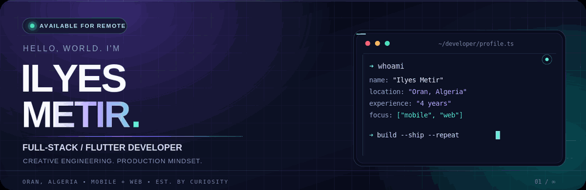
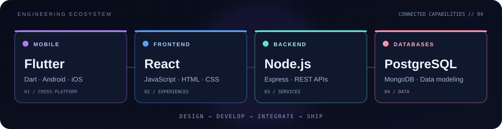
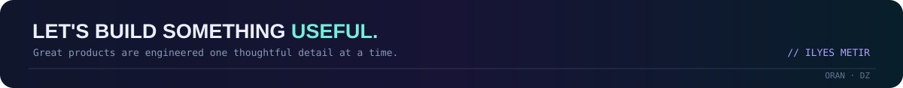

<!--
  ILYES METIR / GITHUB PROFILE — NEON EDITION
  GitHub profile repository: github.com/ilysmxtr/ilysmxtr
  All visuals in assets/ are authored for this profile.
  The portfolio is intentionally NOT duplicated here; it's linked in the GitHub bio.
-->

<div align="center">



<a href="https://github.com/ilysmxtr">
  
</a>

<p>
  
  
  
</p>

</div>

---

### 

I'm **Ilyes Metir**, a **Full-Stack & Flutter Developer** with **4 years of professional experience**, based in Oran, Algeria.

I enjoy engineering the entire product journey: crafting fluid cross-platform interfaces, connecting them to reliable backend services, and taking software from an idea to a polished release.

```javascript
const ilyes = {
  role:       ["Full-Stack Developer", "Flutter Developer"],
  experience: "4 years",
  basedIn:    "Oran, Algeria",
  interests:  ["mobile engineering", "web apps", "product thinking"],
  philosophy: "Clean code. Useful products. Continuous improvement."
};
```

<sub>My projects and detailed work are available through the <b>portfolio link in my GitHub bio</b>.</sub>

### 

<div align="center">



<br />


<br />

<sub>Cross-platform UI · API design · WebSockets · Authentication · State management · Integrations · Shipping</sub>

</div>

### 

<div align="center">

<picture>
  <source media="(prefers-color-scheme: dark)" srcset="https://raw.githubusercontent.com/ilysmxtr/ilysmxtr/output/github-snake-dark.svg" />
  <source media="(prefers-color-scheme: light)" srcset="https://raw.githubusercontent.com/ilysmxtr/ilysmxtr/output/github-snake.svg" />
  
</picture>

<sub>Automatically regenerated daily using GitHub Actions. Contribution statistics reflect GitHub-visible activity.</sub>

</div>

### 

<div align="center">

Interested in a collaboration, a remote engineering opportunity, or a thoughtful product idea?

<a href="https://github.com/ilysmxtr?tab=followers"></a>
<a href="https://github.com/ilysmxtr"></a>

<br />



</div>
